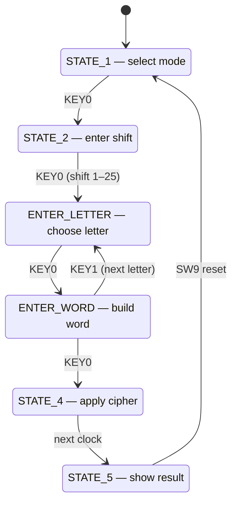

# FPGA Caesar Cipher

A Caesar cipher implemented in Verilog and running on an Intel MAX 10 FPGA (Terasic DE10-Lite board). The user selects encode or decode, sets a shift amount, and enters a word of up to six letters with the board's switches and push buttons. The result is shown on the board's six 7-segment displays.

The design combines combinational logic (the cipher arithmetic, alphabet lookup and 7-segment decoding) with sequential logic (the state machine registers and the clock divider).

## Hardware and tools

| | |
|---|---|
| Board | Terasic DE10-Lite |
| FPGA | Intel MAX 10 (10M50DAF484C6GES) |
| Language | Verilog HDL |
| Toolchain | Intel Quartus Prime Lite 23.1 |
| Clock source | 50 MHz on-board oscillator |

## Controls

| Board input | Signal | Purpose |
|---|---|---|
| SW0–SW4 | `pins[4:0]` | 5-bit binary input. Selects mode (SW0 only), sets shift amount, and enters letters (1 = A … 26 = Z) |
| SW9 | `reset` | Asynchronous reset back to mode selection |
| KEY0 | `top_button` | Confirm / advance to the next step |
| KEY1 | `bottom_button` | Move to the next letter while entering a word |
| HEX5–HEX0 | `hex_5`–`hex_0` | Six 7-segment displays, HEX5 is the leftmost character |
| HEX0 decimal point | `dp` | Lit while a word is being built |

The DE10-Lite push buttons are active-low (they read 0 when pressed), so the design checks `!top_button` and `!bottom_button`.

## How to use it

1. **Pick a mode.** SW0 up shows `ENCODE` and SW0 down shows `DECODE`. Press KEY0.
2. **Set the shift.** Enter a value from 1 to 25 in binary on SW0–SW4. It appears as two decimal digits on HEX5–HEX4. Press KEY0.
3. **Enter a letter.** Set the letter's code on SW0–SW4 (A = 1, B = 2, … Z = 26). The letter shows live on HEX5. Press KEY0 to lock it in.
4. **Build the word.** The word so far is displayed. Press KEY1 to enter the next letter (up to six), or KEY0 to run the cipher.
5. **Read the result.** The encoded or decoded word is displayed. Flip SW9 to reset and start again.

## Design

### Two-process state machine

The top-level module `finalProject` is a finite state machine written in the standard two-process style:

- **A sequential block** (`always @(posedge clk_out or posedge reset)`) holds all state: the current FSM state, the mode, the shift amount, the six letters of the word, and the current letter index. On reset it clears everything and returns to mode selection.
- **A combinational block** (`always @(*)`) reads the registered values, works out the next state and the next register values for the current state, and drives the displays.

Keeping state updates and next-state logic separate gives every register exactly one place where it is written. It also makes each state's behaviour readable as a single `case` branch.



### Clock divider

The `ClockDivider` module counts 25,000,000 cycles of the 50 MHz clock and then toggles its output, which produces a 1 Hz clock. The state machine runs on that slow clock instead of the raw 50 MHz clock. A button is therefore sampled once per second, so a single press moves the FSM one step instead of racing through states thousands of times a second.

### Cipher logic

Each letter is stored as a 5-bit code (1–26). In `STATE_4`, every letter of the word:

1. Is matched against a 26-entry `alphabet` lookup table to find its 0-based position.
2. Has the shift added (encode) or subtracted (decode).
3. Is wrapped around the alphabet. When encoding, a result above 25 has 26 subtracted. When decoding, a negative result has 26 added.
4. Is mapped back to a letter code through the same table.

The loops are written with constant bounds, so Quartus unrolls them into combinational logic and the whole word is processed within one clock cycle.

### 7-segment display decoding

The `ssd` task converts six 6-bit character codes into segment patterns for HEX5–HEX0. Codes 1–26 are the letters A–Z, codes 27–36 are the digits 0–9, and anything else blanks the display. The shift amount is displayed by splitting it into tens and ones with `/ 10` and `% 10` and offsetting each into the digit range (`+ 27`). Quartus synthesizes those operations as small `lpm_divide` blocks.

## Resource usage

From the final Quartus compile (Dec 3, 2024):

| Resource | Used |
|---|---|
| Logic elements | 2,790 / 49,760 (6%) |
| Registers | 77 |
| I/O pins | 52 / 360 |
| Memory bits, multipliers, PLLs | 0 |

Most of the logic comes from the unrolled lookup and wrap-around loops in the cipher state.

## Building and programming

1. Open `quartus/finalProject.qpf` in Quartus Prime Lite (23.1 or later).
2. Run **Processing → Start Compilation**. Pin assignments for the DE10-Lite are already in `quartus/finalProject.qsf`.
3. Connect the board over USB-Blaster and open **Tools → Programmer**.
4. Load `quartus/output_files/finalProject.sof` and click **Start**.

## Known limitations

- The cipher loop covers word positions 0–4, so the sixth letter of a six-letter word is not shifted.
- The alphabet search stops one entry short, so Z is never matched and does not encode or decode correctly.
- Because input is sampled at 1 Hz, a button may need to be held for up to a second to register, and holding it past a second can register twice.
- One word is processed per run. Reset (SW9) to start a new one.

## Repository contents

```
.
├── README.md
├── .gitignore
└── quartus/
    ├── finalProject.v     ClockDivider and the top-level finalProject module
    ├── finalProject.qsf   Device settings and DE10-Lite pin assignments
    └── finalProject.qpf   Quartus project file
```

The Verilog source sits next to the Quartus project files because `finalProject.qsf` references it by a path relative to the project folder.
